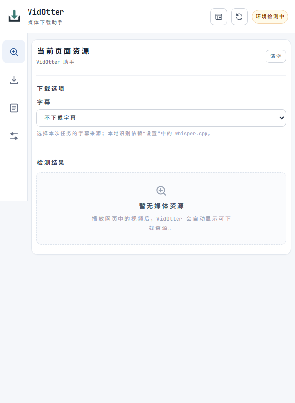

# VidOtter

[English](README.md) · [中文文档](docs/zh-CN/index.md) · [下载发行包](https://github.com/ThinkerQAQ/vidotter/releases)

VidOtter 通过 Chrome/Edge 扩展发现网页媒体，由本机 Go Bridge 下载。支持 HLS、MP4，以及桌面端对部分网页和分离音视频来源的解析。可选工具提供原站字幕、本地语音识别和字幕翻译。Android 是面向媒体直链的独立客户端。

## 安装与首次下载

**安装器状态：** 三平台图形安装器正在开发，尚未发布并完成实机验证。以下压缩包安装流程仍是当前正式支持的方式。[建设说明](docs/zh-CN/how-to/build-installers.md)。


**FFmpeg 许可证声明（Windows 发行包）：** Windows 包附带独立的 **FFmpeg Slim** 可执行文件，所用 FFmpeg 代码采用 **LGPL-2.1-or-later**，不适用 VidOtter 原创代码的 Apache-2.0 授权。当前 [v1.6.2 发行版](https://github.com/ThinkerQAQ/vidotter/releases/tag/v1.6.2)在二进制旁同时提供[准确对应的 FFmpeg 源码包](https://github.com/ThinkerQAQ/vidotter/releases/download/v1.6.2/FFmpeg-n8.1.2-source.tar.gz)；Windows 压缩包内含 `COPYING.LGPLv2.1` 与 `ffmpeg-slim-SOURCE.txt`，说明许可证、源码和构建信息。下载其他版本时应按对应 Release 核实。详见[第三方许可证声明](THIRD_PARTY_NOTICES.md)及 [FFmpeg 官方法律说明](https://ffmpeg.org/legal.html)。

1. 从 [Releases](https://github.com/ThinkerQAQ/vidotter/releases) 下载适合系统和 CPU 架构的发行包，完整解压到固定目录。
2. 在解压目录运行安装命令：Windows PowerShell 使用 `.\bin\vidotterdev.exe install`；Linux/macOS 使用 `./bin/vidotterdev install`。Linux/macOS 需另外安装 FFmpeg 并加入 PATH，用于合并和封装。
3. **必须启用浏览器扩展（无需上架/访问商店）**：打开 Edge 的 `edge://extensions` 或 Chrome 的 `chrome://extensions`，开启“开发者模式”，点击“加载解压缩的扩展”，选择当前安装目录内**直接包含 `manifest.json`** 的 `extension/` 文件夹。Qt 图形安装器会在点击“完成”后自动打开浏览器扩展管理页、该文件夹和随包离线说明 `docs/extension-install.html`。若没有自动打开，可在开始菜单选择 **VidOtter → Install Browser Extension** 重新查看。
4. 播放视频，打开 VidOtter，确认 Bridge 连接状态，在“资源嗅探”中选择目标资源。首次下载选择“不下载字幕”。
5. 到“下载任务”查看任务，等待完成后检查输出文件。

浏览器通过 Native Messaging 按需启动 Bridge。使用发行包不需要安装 Go 或 Node.js。扩展 ID、安装结果和连接检查见[首次使用教程](docs/zh-CN/tutorial/first-run-on-new-machine.md)。

## 支持范围

| 功能 | 桌面端 | Android |
| --- | --- | --- |
| 检测网页媒体 | Chrome/Edge 扩展 | 需要支持扩展的浏览器；也可粘贴或分享直链 |
| MP4/HLS 直链下载 | Go 下载器 | 复用 Go 下载器 |
| 网页解析与分离音视频 | 可选 yt-dlp、FFmpeg，取决于来源 | 暂不普遍支持 |
| 原站字幕 | 可选 yt-dlp | 未集成 |
| 本地识别与翻译 | Windows 包附带可执行程序，模型另行下载 | 未集成 |
| 完整工作区 | 扩展中继 + 本机 Web UI | 原生 App |

检测到资源不代表一定能下载；工具不绕过 DRM。Linux/macOS 发行包不附带 FFmpeg 或本地识别、翻译 sidecar。

## 界面



上图是 v1.3.0 尚未发现媒体时的中文检测页，用于说明界面入口；连接状态与下载结果需按教程在自己的机器上确认。

Popup、Side Panel 和 Web UI 共用任务与设置。从扩展点击“打开工作区”可使用完整页面。设置与运行数据位于 `bin/` 同级的 `Data/`，升级时保留该目录。

## 可选的 AI / MCP 接入

桌面端提供 13 个 MCP 工具，让 ChatGPT 提交公开媒体下载、查询进度、控制任务和读取已完成字幕。MCP 直接复用现有下载引擎，不新建业务服务；浏览器 Cookie 仍只由扩展管理。扩展捕获的媒体通过短期资源 ID 供 MCP 查询；可选安装独立的 Remote Browser Tool 组件，通过同一条 VidOtter Tunnel 操作受限的后台标签页。详见[浏览器自动化组件](docs/zh-CN/how-to/browser-automation.md)。详见 [MCP 接入与安全说明](docs/zh-CN/how-to/mcp.md)。

可选的 Browser Automation 组件现已通过 **Windows 单 MCP 端到端验证**：新建独立后台标签页、由扩展发现公开 MP4、按资源 ID 提交下载、查询完成状态、关闭测试页。测试仅使用 MDN CC0 公开素材；HLS/DASH 下载及自动播放未纳入此次验收。详见[实测流程](docs/zh-CN/how-to/browser-automation.md#已验证单-vidotter-mcp-完整链路windows)。

## 文档

- [快速入门](docs/zh-CN/quick-start.md)、[首次下载](docs/zh-CN/tutorial/first-download.md)
- [工具与模型](docs/zh-CN/how-to/configure-tools.md)、[字幕](docs/zh-CN/how-to/subtitles.md)、[任务与断点续传](docs/zh-CN/how-to/manage-downloads.md)
- [升级与卸载](docs/zh-CN/how-to/upgrade.md)、[故障排查](docs/zh-CN/how-to/troubleshoot.md)、[Android](docs/zh-CN/how-to/android.md)
- [配置与接口参考](docs/zh-CN/reference/index.md)、[架构](docs/zh-CN/architecture/index.md)

## 合法使用与第三方服务声明

VidOtter 是独立的媒体管理工具，与视频平台不存在官方关联。工具不验证媒体的版权或许可状态，也不按照版权归属对下载进行筛选。用户自行负责其下载、保存和分发行为符合适用法律、来源网站条款及第三方权益。项目不绕过 DRM 或访问控制机制。

[Apache-2.0 License](LICENSE) 仅适用于 VidOtter 原创代码，不代表获得第三方媒体内容或打包依赖的授权。第三方组件仍受各自许可证约束，详见[第三方许可证说明](THIRD_PARTY_NOTICES.md)。

**本地隐私：** 下载任务历史可能在本机 `Data/` 中保留来源 URL 或页面 URL，包括带有访问令牌的查询参数。持久化任务会排除 Cookie 和常见授权请求头，但分享任务记录、日志或备份前仍应检查并清理敏感信息。

## 开发

需要 Go 1.24 或更高版本；浏览器测试需要 Node.js。在仓库根目录运行：

```sh
go -C tools/vidotterdev run . verify
go -C tools/vidotterdev run . build
```

产物位于 `.build/out/`，构建不会自动安装。部署与打包见[开发教程](docs/zh-CN/tutorial/development.md)及[工程维护](docs/zh-CN/architecture/maintenance.md)。Agent 约定见 [AGENTS.md](AGENTS.md)。

项目代码和文档采用 [Apache-2.0](LICENSE)；第三方组件采用各自的许可，见 [NOTICE](NOTICE) 和 [THIRD_PARTY_NOTICES.md](THIRD_PARTY_NOTICES.md)。

**卸载（Windows 图形安装器）**：新版开始菜单 → VidOtter → **Uninstall VidOtter**，也可以直接打开安装目录里的 VidOtter-Maintenance.exe，选择 **Remove all components（删除所有组件）** 并确认。Qt 维护工具会清理程序和 Native Messaging 注册，但保留 Data/ 用户配置和下载。旧测试包如果没有开始菜单卸载入口，使用安装目录中的维护工具即可；不要把 VidOtter-Maintenance.exe.new 当作卸载器。
